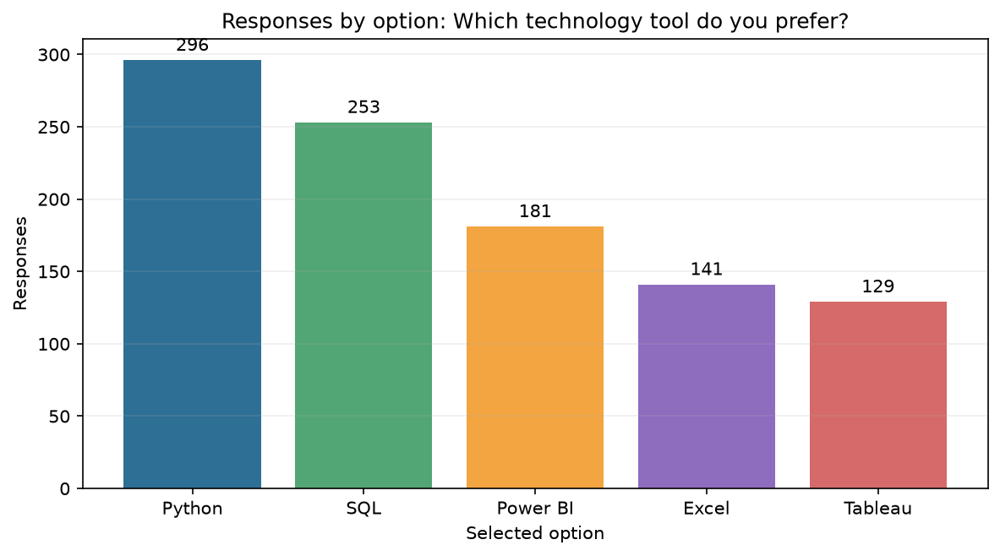
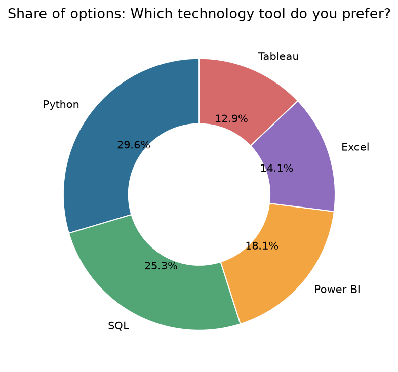
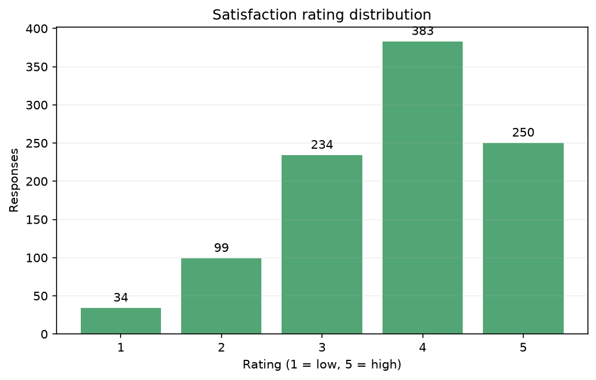
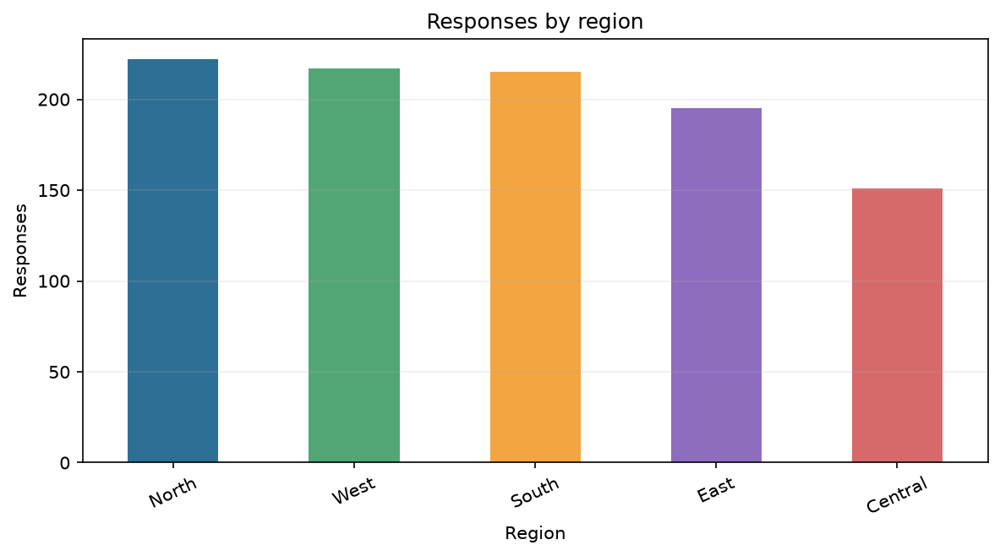
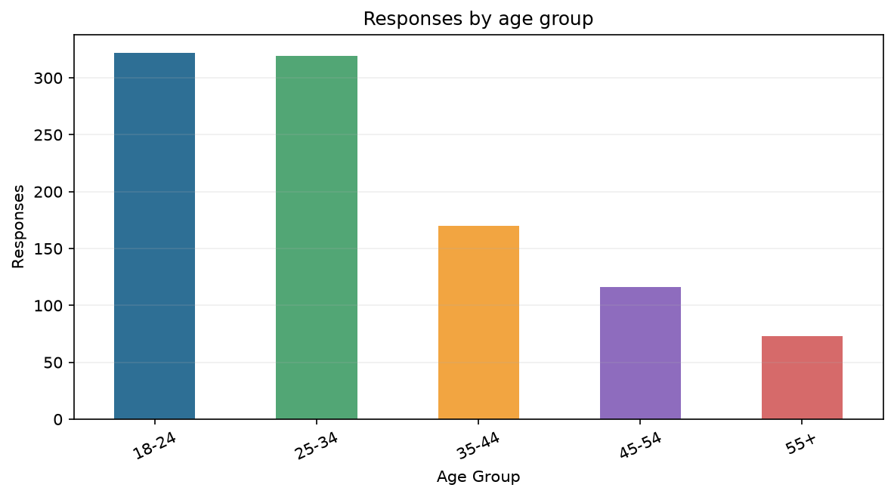

# Poll Results Visualizer

A beginner-friendly Python project for validating poll response data, cleaning
it, calculating per-question results, and presenting the findings in a
Streamlit dashboard or a command-line report.

> **Synthetic-data disclaimer:** The built-in 1,000-row sample is fictional,
> reproducible illustrative data. It is not real polling, a representative
> survey, or an election prediction. All findings describe only the dataset
> currently loaded; response counts do not establish population preference.

## Problem and objectives

Poll responses are easier to understand when their quality is checked and
their counts, percentages, and limitations are presented clearly. This project
demonstrates Python programming, data cleaning, exploratory analysis, charting,
interactive dashboards, automated tests, and practical documentation.

## Features

- Generate a seeded sample dataset or upload a CSV.
- Validate required columns and report quality changes.
- Standardize category text, handle repeated response IDs, parse dates, and
  constrain optional satisfaction scores to 1–5.
- Calculate counts and percentages separately for every question.
- Explore available region, age group, gender, rating, time, and feedback fields.
- Generate bar, donut, rating, time, demographic, and feedback charts.
- Export cleaned data, option summaries, insights, and charts.
- Run the same basic analysis without starting the dashboard.

## Workflow and architecture

**Poll data → validation → cleaning → exploratory analysis → aggregation →
visualization → descriptive insights → dashboard/exports.**

Validation checks the required schema before cleaning. Cleaning makes category
labels consistent, removes records with missing required values and repeated
IDs, safely parses timestamps, and sets ratings outside 1–5 to missing rather
than silently dropping responses. Analysis calculates percentages using the
valid responses for each question—not the combined total across unrelated
questions. Visualizations and insight text describe the supplied records; no
statistical significance or population inference is claimed.

See [architecture](docs/ARCHITECTURE.md),
[project overview](docs/PROJECT_OVERVIEW.md), and
[data dictionary](docs/DATA_DICTIONARY.md).

## Technology

Python, pandas, NumPy, Matplotlib, Streamlit, WordCloud, and pytest.

## Project structure

```text
Poll-Results-Visualizer/
├── app.py
├── main.py
├── requirements.txt
├── README.md
├── LICENSE
├── data/
│   ├── raw/                 # small sample input; generated input is local
│   └── processed/
├── src/
│   ├── data_generator.py
│   ├── data_loader.py
│   ├── data_cleaning.py
│   ├── analysis.py
│   ├── visualizations.py
│   └── insights.py
├── tests/
├── docs/
├── images/
└── outputs/
    ├── charts/
    ├── cleaned_data/
    └── reports/
```

Generated outputs and the generated input CSV are excluded from Git by
`.gitignore` so they can be recreated locally. `images/` is reserved for genuine
screenshots; no unverified screenshots or results are included.

## Dataset

The default generator creates 1,000 responses to the illustrative question
“Which technology tool do you prefer?” with five options, fictional dates,
demographic categories, a 1–5 rating, and short sample feedback. The default
seed is `42`; running the generator again overwrites the same CSV rather than
appending more responses. See the [data dictionary](docs/DATA_DICTIONARY.md).

The repository also includes a 25-row sample at
[`data/raw/sample_poll_responses.csv`](data/raw/sample_poll_responses.csv).

An uploaded CSV must contain `Response_ID`, `Question`, and `Selected_Option`.
`Timestamp`, `Age_Group`, `Gender`, `Region`, `Satisfaction_Rating`, and
`Feedback` are optional. Missing optional columns disable only the related
analysis. Ratings that are invalid or outside 1–5 become missing; invalid dates
become missing. Required-field rows and duplicate response IDs are removed and
counted in the quality summary.

## Windows PowerShell setup

From a terminal, move to this project directory and create a Python 3.13
environment (Python 3.13.9 was used for the initial validation):

```powershell
Set-Location "C:\path\to\Poll-Results-Visualizer"
py -3.13 --version
py -3.13 -m venv .venv
.\.venv\Scripts\Activate.ps1
python -m pip install --upgrade pip
python -m pip install -r requirements.txt
```

Replace the example `Set-Location` path with the folder where you saved the
project.

If PowerShell blocks environment activation, run
`Set-ExecutionPolicy -Scope Process -ExecutionPolicy Bypass` in that terminal,
then activate again. Alternatively, run `.\.venv\Scripts\python.exe` instead
of activating the environment. If `py -3.13` is unavailable, install Python
3.13 and enable the Windows Python launcher.

## Generate data and run analysis

```powershell
python -m src.data_generator
python main.py
```

The generator's documented library call is
`save_synthetic_data()`. The full `python main.py` command regenerates the
default CSV, cleans it, saves charts under `outputs/charts/`, the cleaned CSV
under `outputs/cleaned_data/`, and the option summary, quality JSON, and
insights under `outputs/reports/`.

To analyze your own file without overwriting the sample input:

```powershell
python main.py --input "C:\path\to\your_poll.csv"
```

To change the generated sample size and seed:

```powershell
python main.py --sample-size 500 --seed 123
```

## Launch the dashboard

```powershell
streamlit run app.py
```

Open the local address printed by Streamlit. Choose the built-in synthetic
sample or upload a CSV, select a question, and adjust available filters. The
dashboard displays relevant charts, a data-quality summary, insights, a
preview, and CSV/text downloads. The “Save filtered charts” button exports
the current charts to `outputs/charts/`.

## Tests

```powershell
python -m pytest -v
```

The test suite covers CSV upload behavior (including a missing-required-column
error), cleaning, per-question percentages, insights, and generated chart files.
Test scope, Python version, and the executed results are recorded in
[docs/TESTING.md](docs/TESTING.md).

## Visualization gallery and measured results

Charts below are the real generated outputs from the CLI pipeline; regenerate
them locally with `python main.py`. They show only the synthetic sample and
should not be interpreted as evidence about people or populations.

| Chart | Generated example (synthetic sample) |
|---|---|
| Poll option counts |  |
| Within-question option share |  |
| Rating distribution |  |
| Region comparison |  |
| Age group comparison |  |

Measured CLI results for the reproducible 1,000-row sample (seed 42): 1,000
valid responses; one question and five available options; the leading option
was Python (296 responses, 29.6%) and the least-selected was Tableau
(129 responses, 12.9%); mean satisfaction was 3.72/5; the most-recorded region
was North (222 responses). These are sample calculations only—not claims about
real respondents. CLI cleaning removed zero rows.

Additional genuine screenshots from this local run:

| Proof | Image |
|---|---|
| Actual project file listing | [Project overview](images/01_project_overview.png) |
| Sample CSV preview | [Raw dataset preview](images/02_dataset_preview.png) |
| Cleaning quality JSON | [Data quality](images/03_data_quality.png) |
| Actual option summary | [Vote counts and shares](images/04_vote_summary.png) |
| Running Streamlit application | [Dashboard](images/10_streamlit_dashboard.png) |
| Generated report | [Insights](images/11_generated_insights.png) |
| Captured pytest output | [Test results](images/12_test_results.png) |
| Captured CLI output | [CLI execution](images/13_cli_execution.png) |
| Actual cleaned CSV preview | [Cleaned data](images/14_cleaned_data.png) |

The screenshots show real files or application output generated in this run.
Test and CLI evidence images display the captured command output; they are not
fabricated terminal mockups or claims about real-world polling.

## Limitations and future improvements

The sample data is synthetic, category breakdowns are descriptive, and the
feedback word cloud measures displayed word frequency rather than sentiment.
The tool does not perform statistical inference, weighting, or representative
sampling. Possible extensions include additional question types, accessibility
improvements, and configurable validation rules.

## License

Released under the [MIT License](LICENSE).
